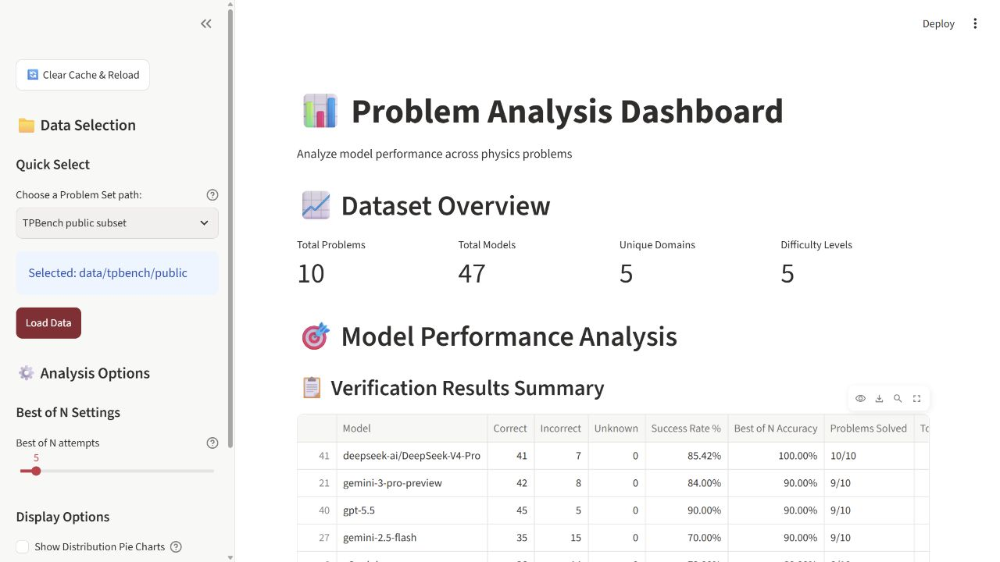
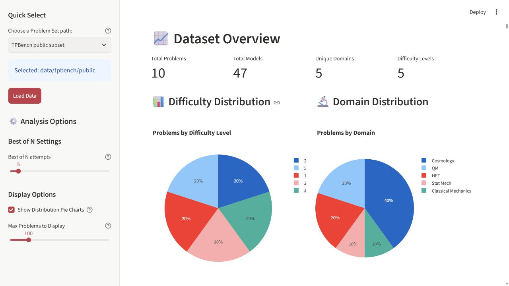
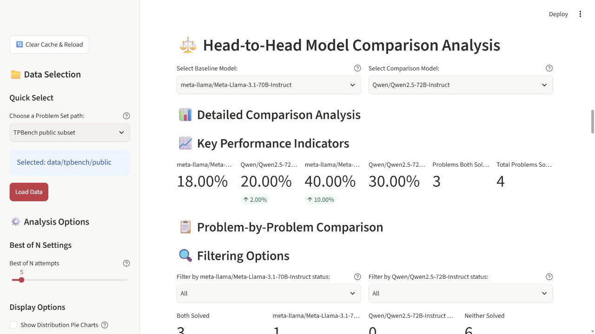
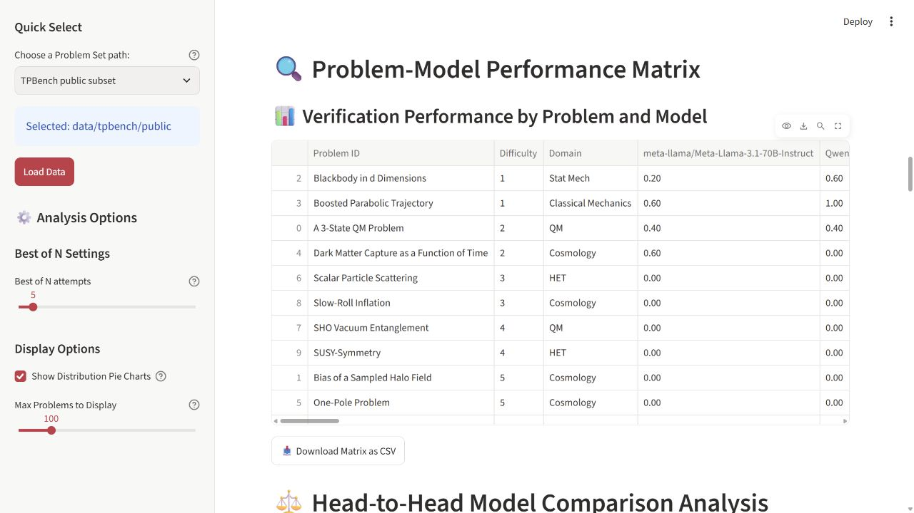
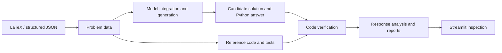

# Physics LLM Evaluation: Research Software Portfolio

**Zichang (Stephen) Xu · Undergraduate researcher, University of Wisconsin–Madison**

This portfolio presents selected software from my work on evaluating language-model
reasoning in theoretical physics. It connects structured problem data, model-generated
solutions, executable verification, and analysis tools. The source comes from a
collaborative research project advised by **Prof. Moritz Münchmeyer**, with
**Nate Woodward** as my graduate mentor. The original `llm_physics` project
supports TPBench and related physics-reasoning experiments.

The runnable demonstration uses **two newly written elementary mechanics examples**
and hand-written candidate responses. Its outcomes demonstrate software behavior;
they are separate from the research benchmark and its scientific results.

## Start here

1. View [the running software](#see-the-software-in-action) and read
   [my contributions](#my-contributions) to see my responsibilities.
2. Inspect [the verification code](main/solution_grader.py),
   [data conversion](file_utils/parse_dataset_tex.py), and
   [generation orchestration](main/solution_generator.py).
3. Run the [offline demonstration](#run-the-offline-demonstration) or inspect
   [the example walkthrough](docs/DEMO.md).

## My contributions

I was a **primary contributor** to the following workflows, implementing components
independently with graduate-researcher review and co-developing others with graduate
collaborators. These roles describe my work within the collaborative project.

| Area | My work | Representative code |
| --- | --- | --- |
| Data preparation and conversion | Structured problem data, LaTeX-to-JSON conversion, and dataset preparation workflows | [Parser](file_utils/parse_dataset_tex.py), [JSON helpers](file_utils/file_utils.py) |
| Reference implementations and tests | Reference-code and test-case workflows used to check candidate answers | [Verifier](main/solution_grader.py), [fixture schema](data/demo/demo_constant_acceleration.json) |
| Model integration and generation | Model integration, prompt construction, batch generation, and resuming attempts | [Generator](main/solution_generator.py), [shared infrastructure](main/problem_processor_base.py) |
| Automated code verification | Extracting executable answers, running test cases, and comparing outputs | [Grading pipeline](main/solution_grader.py) |
| Cross-platform maintenance | Linux/macOS/Windows compatibility, environment configuration, and verification tests | [Windows setup](scripts/setup_windows.ps1), [compatibility tests](tests/test_windows_compat.py) |

I also **helped build and studied**, under graduate mentorship:

- **Reasoning-error classification:** factual, mathematical, logical, and implementation
  errors; see [the classifier](rollout_analysis/stage4_error_classifier.py).
- **Response analysis:** length, entropy, mathematical content, code, and structural
  features; see [feature extraction](scripts/rollout_stats/feature_extractors.py).
- **Interactive analysis:** a Streamlit interface for inspecting problems, candidate
  responses, and verification outcomes; see [the dashboard](streamlit_visualization/app.py).

My physics-content contributions were concentrated on **difficulty levels 1–3**.
Graduate researchers reviewed the physics content and provided subject-matter guidance
for advanced problems. The broader reasoning-analysis pipeline is included as
collaborative context for the modules I helped build.

## See the software in action

These are **actual browser captures of the original research dashboard**, using
its `data/tpbench/public` subset: **10 problems, 47 model entries, 5 physics domains,
and 5 difficulty levels**. They show stored evaluation records, rather than a new
inference run or a full-benchmark leaderboard. Internal filesystem identifiers are
display-aliased; numerical results are unchanged. The downloadable offline demo
uses the separate educational fixtures described above.

### 1. Evaluation overview and verification summary



The overview connects the dataset scope to accepted/rejected code-verification
outcomes, success rates, and the number of problems solved. Success rates are
computed from the graded attempts available for each model in this subset.

### 2. Dataset difficulty and domain coverage



The distributions make the evaluation scope visible: this subset includes two
problems at each difficulty level, across five physics domains. This view helps
check coverage across the intended task categories and difficulty levels.

### 3. Comparing models on the same problem set



The comparison view distinguishes attempt-level success from whether a problem
was solved within the first five available attempts. It also shows overlap in
solved problems, helping identify where two models succeed on different tasks.

### 4. Inspecting verification outcomes problem by problem



Each cell summarizes the fraction of graded attempts accepted for that
problem/model pair. The displayed Llama and Qwen columns expose differences at
individual-problem level; the full interface supports additional model columns,
filtering, and result export. The screenshot shows problem titles, not solutions
or model reasoning traces.

## How the software fits together



The offline demo starts with hand-written candidates at the candidate-solution stage.
The optional research-analysis stages split reference solutions, distill candidate
steps, match steps, and classify errors. LLM-produced error labels require review;
code-test outcomes and reasoning annotations answer different evaluation questions.

## Run the offline demonstration

Use Python **3.11 or 3.12**. From the repository root:

```bash
python -m venv .venv
# Windows PowerShell: .\.venv\Scripts\Activate.ps1
# macOS/Linux: source .venv/bin/activate
python -m pip install -r requirements.txt
python demo.py
python scripts/convert_demo.py
python -m unittest discover -s tests -v
```

No API key or GPU is needed. The demo writes graded copies under `output/demo/`,
leaving the source fixtures unchanged. Expected outcomes for each problem are
`demo-correct: verified=1` and `demo-incorrect: verified=0`.

The verifier executes reference and candidate Python code. Run the bundled trusted
fixtures locally; use an isolated container or VM before evaluating untrusted code.
Process timeouts and removing inherited API variables are not a security sandbox.

## Open the analysis dashboard

```bash
python -m pip install -r requirements-dashboard.txt
python demo.py
python -m streamlit run streamlit_visualization/app.py
```

Choose **Demo results** and click **Load Data**. The dashboard compares the two
hand-written candidate types and displays their verification outcomes.

## Optional model generation and analysis

Install `requirements-api.txt`, set the provider's API key in your environment, and
pass an explicit model identifier supported by your account:

```bash
python main/main.py --problems_dir data/demo --model_name YOUR_MODEL_ID --num_attempts 1
```

This optional command makes paid provider requests and stores generated attempts in
the chosen problem files. Keep generated data out of public commits. Supported provider
adapters are in the source; live APIs and GPU/vLLM execution are outside the offline
demonstration's validation. The local-GPU route requires a separate compatible
PyTorch/vLLM environment.

For the four-stage analysis source, see [analysis notes](docs/ANALYSIS.md).
For optional LaTeX reports, see [the demo guide](docs/DEMO.md).

## Release scope and provenance

This is a curated source snapshot with selected aggregate dashboard screenshots.
Private questions, original solutions and test
cases, model rollouts, training data, unpublished results, weights, cluster scripts,
credential files, and Git history are excluded. New educational fixtures and
portfolio adapters are identified in [provenance](docs/PROVENANCE.md).

See [NOTICE](NOTICE.md) for collaborative attribution and licensing status.
